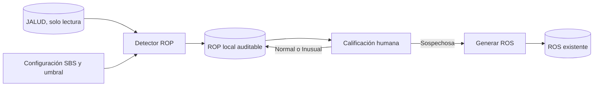

# Conocimiento del módulo ROP

## Contexto

ROP se incorpora antes de ROS. No captura de nuevo la operación: detecta créditos generados en JALUD, conserva sus identificadores y fija un snapshot histórico de los datos disponibles al incorporarlos.

## Arquitectura relevante

## Fuente JALUD

- `Cliente`: DNI, nombres, fecha de nacimiento, domicilio, cónyuge, garante y sede.
- `ProposicionCredito`: código, cliente, monto original, plazo, cuotas, tasas, zona, estado y sede.
- `Credito`: identidad definitiva de la operación, fecha de generación, vigencia y tipo de pago.
- `pago`: importes, fechas, medio y conceptos asociados al crédito.
- `Negocio`, `Ciudad`, `Zona`, `Sede`, `TipoCredito` y `TipoPago`: contexto disponible.
- `Cliente.GaranteID`: única garantía estructurada actualmente disponible.

## Fuente local de Cumplimiento

- La última `DeclaracionCliente` finalizada complementa nacionalidad, estado civil, ocupación, teléfonos y domicilio desagregado.
- `RosConfiguracion` ya contiene organismo supervisor, tipo de sujeto obligado, códigos y domicilio institucional por sede.
- `RosPrefillService` y las relaciones de `RosCaso` son el punto de extensión para generar un ROS desde un ROP sospechoso.
- `BelongsToSede` limita las consultas según el usuario y su sede.

## Reglas derivadas de los requisitos

- La operación candidata es un crédito efectivamente generado, no una propuesta sin crédito.
- El monto se compara de forma estricta (`MontoTotal > umbral`) porque el requisito dice “supere”.
- La fecha de operación es `Credito.FechaGeneracion`; solo se usan fechas de la propuesta como respaldo si el dato operativo falta.
- El umbral se lee de configuración por sede.
- El identificador operativo para deduplicar es `CreditoID` y queda protegido también con una restricción única.
- El correlativo se forma a partir del identificador local autoincremental, sin consultar un `MAX()` vulnerable a carreras.
- Normal, Inusual y Sospechosa son las únicas calificaciones.
- Generar ROS requiere calificación Sospechosa y es idempotente: un ROP solo puede enlazar un ROS.
- Cerrar un período exige que sus ROP estén calificados y después impide recalificarlos.

## Formato Excel

La plantilla exige:

- identificación del ROP y del sujeto obligado;
- monto, moneda, forma de pago/desembolso, tipo y oportunidad de operación;
- identificación de persona natural o jurídica;
- domicilio, teléfonos, actividad, estado civil y representante cuando aplique.

Los campos disponibles se rellenan desde JALUD, la declaración finalizada y la configuración SBS. Los datos inexistentes quedan vacíos; no se crean valores regulatorios ficticios.

## Puntos de extensión

- Nuevas reglas de detección pueden añadirse al detector sin cambiar el origen de datos.
- Nuevos tipos operativos necesitarán una clave de origen equivalente a `CreditoID` antes de activarse.
- El exportador debe trabajar sobre una copia de la plantilla empaquetada, sin alterar el archivo fuente.

